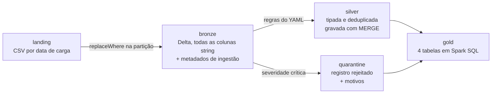

# Pipeline Incremental de Movimentações de Cartão

Pipeline em arquitetura medalhão (landing, bronze, silver, gold) para movimentações de cartão da Cooperativa NovaRota, feito em PySpark e Spark SQL sobre Delta Lake.

O mesmo código roda em dois ambientes: um container Docker local e um workspace Databricks. A massa de dados é fictícia, gerada pelo próprio repositório, com defeitos plantados em quantidade conhecida para que os testes possam conferir números exatos.

## Sumário

- [Arquitetura](#arquitetura)
- [Como executar](#como-executar)
- [Configuração declarativa](#configuração-declarativa)
- [Decisões técnicas](#decisões-técnicas)
- [Massa de dados e defeitos plantados](#massa-de-dados-e-defeitos-plantados)
- [Testes](#testes)
- [Consultas analíticas](#consultas-analíticas)
- [Evidências de execução](#evidências-de-execução)
- [Premissas](#premissas)
- [Limitações e próximos passos](#limitações-e-próximos-passos)

## Arquitetura



Por camada:

**Bronze.** Lê o CSV com todas as colunas como string e grava em Delta sem transformar nada. São acrescentadas cinco colunas de metadados: `arquivo_origem`, `data_referencia`, `timestamp_ingestao`, `config_version` e `hash_linha`.

**Silver.** Aplica tipagem, as regras de qualidade, a deduplicação pela chave de negócio e a integridade referencial. Os registros com erro de severidade crítica vão para a quarentena junto com a lista de motivos e registro com erro de severidade alerta segue para a silver com o aviso gravado na coluna `alertas`.

**Gold.** Quatro tabelas materializadas a partir de arquivos `.sql`, lidos e executados por um motor em Python. As tabelas são `gold_transacoes_cartao`, `gold_resumo_cliente_mes`, `gold_ranking_estabelecimento` e `gold_alertas_qualidade`.

### Estrutura do repositório

```
conf/pipeline.yml              configuração das entidades e regras
src/config.py                  caminhos, SparkSession e leitura do YAML
src/pipeline.py                orquestração e CLI
src/utils/logging.py           logger e medição de etapas
src/ingestion/bronze.py        ingestão
src/quality/rules.py           aplicação das regras e separação de rejeitados
src/transformations/silver.py  tipagem, dedup, integridade, merge
src/transformations/gold.py    motor que executa os .sql
sql/                           4 arquivos da gold
sql/analises/                  4 consultas analíticas
scripts/gerar_massa.py         geração da massa fictícia
scripts/executar_analises.py   execução das consultas e gravação da evidência
tests/                         suíte pytest
notebooks/                     entrada para execução no Databricks
docs/evidencias/               saídas das execuções
```

## Como executar

### Local com Docker

Não precisa ter Python, Java ou Spark na máquina pois a imágem resolve todas as dependências.

```bash
docker compose build

# pipeline completo, gerando a massa antes
docker compose run --rm pipeline python -m src.pipeline --gerar-massa

# suíte de testes
docker compose run --rm tests
```

A CLI também executa camadas isoladas e aumenta o volume da massa:

```bash
docker compose run --rm pipeline python -m src.pipeline --camadas silver gold
docker compose run --rm pipeline python -m src.pipeline --gerar-massa --escala 10
```

Os dados ficam em `data/`, que não é versionado.

### Local sem Docker

Precisa de Python 3.11 e JDK 17 instalados.

```bash
pip install -r requirements-local.txt
python -m src.pipeline --gerar-massa
pytest
```

### Databricks

O código roda sem alteração. A diferença fica na raiz dos dados, apontada pela variável de ambiente `PIPELINE_DATA_ROOT` para um Volume do Unity Catalog.

1. Clonar o repositório no workspace.
2. Criar o catálogo, o schema e o Volume que vão receber os dados.
3. Rodar `notebooks/run_tests`, que instala as dependências e executa a suíte.
4. Rodar `notebooks/run_pipeline`, que executa o pipeline e registra as tabelas da gold como managed tables.

O passo a passo detalhado está em `docs/EXECUCAO_NO_DATABRICKS.md`.

## Configuração declarativa

Todas as configurações ficam em `conf/pipeline.yml`. As cinco entidades declaram seu arquivo de origem, a chave de negócio, a coluna de versão, os tipos de cada coluna, as regras de qualidade e a integridade referencial.

```yaml
transacoes:
  arquivo_padrao: "transacoes_cartao_{data}.csv"
  particionado_por_data: true
  chave_negocio: [id_transacao]
  coluna_versao: data_transacao
  tipos:
    id_transacao: string
    valor: decimal(18,2)
    data_transacao: timestamp
  regras_qualidade:
    - nome: valor_nao_positivo
      expressao: "valor > 0"
      severidade: critica
    - nome: mcc_formato_invalido
      expressao: "mcc rlike '^[0-9]{4}$'"
      severidade: alerta
  integridade_referencial:
    - coluna: id_cartao
      referencia: cartoes
```

Para acrescentar uma regra de qualidade basta editar o YAML. O arquivo tem um `config_version`, gravado em cada linha da bronze, então sempre dá para saber com qual versão das regras um registro foi processado.

O `src/config.py` é o único módulo que conhece caminho físico. Ele detecta o ambiente, monta a SparkSession adequada e resolve os caminhos de cada camada. O resto do código pede o caminho para ele.

## Decisões técnicas

### data_referencia e data_transacao são colunas diferentes

`data_referencia` é a data da carga, extraída do nome do arquivo. `data_transacao` é a data em que a transação aconteceu. Separar as duas é o que deixa o reprocessamento seguro.

A bronze é particionada por `data_referencia`. Uma transação atrasada que aconteceu em agosto mas veio no arquivo de outubro, fica na partição de outubro. Assim, a partição responde em qual arquivo o registro chegou. Se eu particionasse pela data do evento, reprocessar o arquivo de outubro mexeria nas partições de agosto e setembro, e o reprocessamento perderia o isolamento.

### replaceWhere na bronze, MERGE na silver

As duas camadas são idempotentes, mas a unidade de reprocessamento muda.

Na bronze a unidade é o arquivo. Reprocessar uma carga sobrescreve exatamente a partição daquela carga, com `replaceWhere`, e as outras partições ficam intactas.

Na silver a unidade é o registro. A dedup pode trocar qual versão de um cliente é a vigente, então o que preciso é atualizar aquela chave sem mexer no resto. Por isso o `MERGE` pela chave de negócio.

### hash_linha como critério de desempate na dedup

A dedup usa `ROW_NUMBER` particionado pela chave de negócio e ordenado pela coluna de versão em ordem decrescente. O problema aparece no empate, com duas linhas com a mesma chave e a mesma versão, que é o caso de uma duplicata exata. Aí o `ROW_NUMBER` escolhe qualquer uma das duas, e a escolha pode mudar de uma execução para outra.

O `hash_linha` é um SHA-256 calculado só sobre os campos de negócio, sem os metadados de ingestão. Duas duplicatas exatas têm o mesmo hash e linhas diferentes têm hashes diferentes. Usando o hash como segundo critério de ordenação, o resultado passa a ser igual em qualquer execução.

### Validação antes da deduplicação

A ordem muda o resultado. Se a dedup rodasse primeiro, um cliente cuja versão mais recente tem CPF inválido ficaria sem nenhum representante na silver. A versão nova seria eleita vigente e depois rejeitada, e a versão antiga, que era válida, iria embora junto.

Validando antes, as versões inválidas vão para a quarentena e a dedup escolhe a mais recente entre as que passaram. O cliente continua na silver, com o dado válido que existia.

Quem cobre esse caso é o `test_cliente_duplicado_mantem_a_versao_valida_mais_recente`.

### Integridade referencial contra silver mais quarentena

A verificação de integridade responde se a chave existe, e não se o registro referenciado tem boa qualidade. Por isso a checagem é feita contra a união da silver com a quarentena da entidade referenciada.

Validando só contra a silver a rejeição cascateia. Em uma execução realizada, clientes com CPF inválido levaram transações legítimas para a quarentena, porque o cartão dessas transações aponta para um cliente que está na quarentena e não na silver. A transação não tinha defeito nenhum. O defeito estava no cadastro do cliente, e já havia sido registrado no lugar certo.

Transação com chave que não existe em lugar nenhum continua sendo rejeitada.

### Precedência da silver no enriquecimento da gold

A gold precisa enriquecer a transação com cartão, conta e cliente vindos das duas fontes. Cada CTE faz `UNION ALL` da silver com a quarentena, filtrando a quarentena por `NOT EXISTS` na silver.

Sem esse filtro, uma chave que está nas duas tabelas entra duas vezes e duplica a transação.

### Estorno como flag

O estorno é marcado na própria transação, com a coluna `estornada` e a coluna `valor_liquido`, que fica zerada quando a transação foi estornada.

A outra opção seria deixar a gold filtrar o estorno em cada consulta. Aí qualquer consulta que esquecesse o filtro contaminaria o indicador. Com o `valor_liquido` já calculado na silver, somar a coluna errada passa a ser uma decisão explícita.

### Severidade crítica e alerta

Regra crítica manda o registro para a quarentena. Regra de alerta deixa o registro passar e grava o aviso em um array na coluna `alertas`.

O que separa as duas é se o dado ainda é utilizável. CPF inválido inviabiliza o cadastro. UF fora da lista é um dado ruim em um campo que não impede a transação de ser contada. Se eu marcasse tudo como crítico estaria descartando registro bom, e se marcasse tudo como alerta estaria deixando passar registro inutilizável.

### Gold em arquivos .sql

As quatro tabelas da gold são arquivos SQL em `sql/`, lidos e materializados pelo `src/transformations/gold.py`.

O `gold_alertas_qualidade` é um `UNION ALL` explícito de dez blocos, um por regra, em vez de uma construção genérica. Ficou mais verboso de propósito, porque quem consulta essa tabela precisa entender de onde cada linha veio.

### Schema declarado, sem mergeSchema

O schema vem do YAML e a gravação não usa `mergeSchema`. Qualquer coluna nova no arquivo de origem faz a execução falhar, e esse é o comportamento esperado.

### Portabilidade entre os dois ambientes

O `get_spark()` tem dois caminhos. No local, monta a sessão com as extensões do Delta, que não vêm no PySpark. No Databricks, pega a sessão ativa do runtime, onde o Delta já é nativo. O resto do código não sabe em qual ambiente está rodando.

## Massa de dados e defeitos plantados

A massa é gerada pelo `scripts/gerar_massa.py` com semente fixa, então o resultado é idêntico em qualquer execução e em qualquer ambiente. São três cargas, cobrindo três meses, para as consultas de crescimento mensal terem o que comparar.

| Arquivo | Linhas |
|---|---|
| clientes.csv | 318 |
| contas.csv | 340 |
| cartoes.csv | 400 |
| transacoes_cartao_20260814.csv | 1809 |
| transacoes_cartao_20260916.csv | 2412 |
| transacoes_cartao_20261015.csv | 1507 |
| estornos.csv | 174 |

Os defeitos são declarados em um dicionário no topo do script, com quantidade exata:

| Entidade | Defeito | Quantidade | Destino |
|---|---|---|---|
| clientes | duplicados com data diferente | 18 | dedup |
| clientes | CPF com dígito verificador errado | 11 | quarentena |
| clientes | CPF malformado | 7 | quarentena |
| clientes | UF fora da lista | 6 | alerta |
| contas | sem cliente correspondente | 9 | quarentena |
| contas | status fora do domínio | 8 | quarentena |
| cartoes | sem conta correspondente | 12 | quarentena |
| cartoes | bandeira fora do domínio | 7 | alerta |
| transacoes | duplicadas | 28 | dedup |
| transacoes | valor negativo | 19 | quarentena |
| transacoes | data futura | 10 | quarentena |
| transacoes | atrasadas | 34 | silver |
| transacoes | sem cartão correspondente | 12 | quarentena |
| estornos | sem transação correspondente | 14 | quarentena |

Os defeitos são sorteados por uma função que tira uma amostra única e a divide em fatias sem interseção.

O resultado dessa execução, em linhas:

| Camada | clientes | contas | cartões | transações | estornos |
|---|---|---|---|---|---|
| bronze | 318 | 340 | 400 | 5728 | 174 |
| silver | 285 | 323 | 388 | 5659 | 160 |
| quarentena | 18 | 17 | 12 | 41 | 14 |
| duplicatas removidas | 15 | 0 | 0 | 28 | 0 |

Gold: `gold_transacoes_cartao` 5659 linhas, `gold_resumo_cliente_mes` 463, `gold_ranking_estabelecimento` 80, `gold_alertas_qualidade` 11.

## Testes

110 testes em pytest, em seis arquivos:

| Arquivo | Testes | O que cobre |
|---|---|---|
| test_smoke.py | 6 | sessão Spark, timezone, resolução de caminhos |
| test_config.py | 11 | consistência do YAML |
| test_gerador_massa.py | 20 | determinismo e contagem exata dos defeitos |
| test_bronze.py | 17 | metadados, hash, idempotência do replaceWhere |
| test_silver.py | 26 | validação de CPF, dedup, integridade, merge |
| test_gold.py | 30 | enriquecimento, agregações, funções de janela |

Como a massa tem defeito em quantidade conhecida, os testes podem afirmar número exato.

Os testes de configuração verificam o próprio YAML, que a chave de negócio existe entre os tipos declarados, que nomes de regra não se repetem na entidade, que toda entidade tem ao menos uma regra crítica e que a integridade referencial aponta para entidade e coluna existentes.

### Resultado nos dois ambientes

| | local | Databricks |
|---|---|---|
| Spark | 3.5.3 com Delta 3.2.1 | 4.2.0 |
| Python | 3.11.18 | 3.11.11 |
| Resultado | 110 passed em 206.8s | 109 passed, 1 skipped em 439.0s |

O teste ignorado é o `test_delta_habilitado_na_sessao_local`, que confere se a sessão local carregou a extensão do Delta. No Databricks o Delta é nativo do runtime e essa configuração não existe, então marquei o teste com `skipif` para o ambiente. O teste que valida o comportamento do Delta, gravar e ler uma tabela, roda nos dois e passa nos dois.

As contagens de linha são idênticas nos dois ambientes.

## Consultas analíticas

Quatro consultas em `sql/analises/`, executadas pelo `scripts/executar_analises.py`. Não são materializadas, porque são análise sob demanda e não tabela de consumo.

| Arquivo | Funções usadas | Linhas |
|---|---|---|
| crescimento_mensal_clientes.sql | LAG | 70 |
| evolucao_mensal_cliente.sql | LAG, LEAD, ROW_NUMBER | 463 |
| quartis_clientes.sql | NTILE, DENSE_RANK | 156 |
| ranking_estabelecimentos_por_cidade.sql | ROW_NUMBER, DENSE_RANK, SUM OVER | 24 |

A primeira retorna os clientes com crescimento acima de 50% em relação ao mês anterior. A terceira separa a base em quartis por volume movimentado. A quarta traz os três maiores estabelecimentos de cada cidade, com a participação de cada um no total da cidade.

A gold também usa `DENSE_RANK` no `gold_ranking_estabelecimento`, em três ordenações diferentes.

## Evidências de execução

Em `docs/evidencias/`:

- `suite_de_testes_local.txt`, suíte no container
- `execucao_pipeline_local.txt`, pipeline no container, com o log de cada etapa
- `consultas_analiticas.txt`, as quatro consultas com o SQL e as primeiras linhas do resultado
- `suite_databricks.txt`, suíte no Databricks
- `run_tests.ipynb` e `run_pipeline.ipynb`, notebooks com a saída preservada

O log do pipeline registra início, fim e duração de cada etapa, e também a contagem de entrada, aprovados, quarentena e duplicatas removidas por entidade. A medição de etapa é um context manager no `src/utils/logging.py`, o que mantém a instrumentação fora da lógica de transformação.

## Premissas

**A quarentena guarda o registro inteiro.** O registro vai para a quarentena com os valores originais preservados em colunas `<coluna>_original`, mais a lista de motivos. Dá para corrigir e reprocessar sem voltar ao arquivo de origem.

**Cadastro cancelado não é defeito.** Os cartões com status cancelado são estado válido de negócio e passam para a silver. A transação feita com cartão cancelado também passa e fica visível na gold pela coluna de status.

**Data de referência de cadastro é a data da execução.** Clientes, contas e cartões vêm em arquivo sem data no nome, então a `data_referencia` desses registros é a data em que o pipeline rodou.

## Limitações e próximos passos

**Não tem SCD2 nos cadastros.** A silver guarda a versão vigente de cada cliente, conta e cartão, e não o histórico. Na prática isso significa que a gold mostra o estado atual do cadastro, e não o estado no momento da transação. Um cartão hoje cancelado aparece como cancelado em todas as transações dele, inclusive nas que foram feitas quando ele estava ativo.

Para resolver, a silver de cadastro precisaria de `valido_de`, `valido_ate` e um indicador de versão corrente, e o enriquecimento da gold passaria a casar a transação com a versão vigente na data do evento.

**A qualidade não tem janela de tolerância.** A regra é binária. Ou o registro passa, ou vai para a quarentena. Não existe hoje um limite do tipo falhar a execução se mais de 5% dos registros forem rejeitados. O `gold_alertas_qualidade` já tem os números para isso, falta decidir o que fazer quando o limite estourar.

**O reprocessamento é manual.** A CLI permite reprocessar camada e carga, mas quem decide o que reprocessar é a pessoa. Não existe controle de carga processada que deixe o pipeline descobrir sozinho o que ficou pendente.